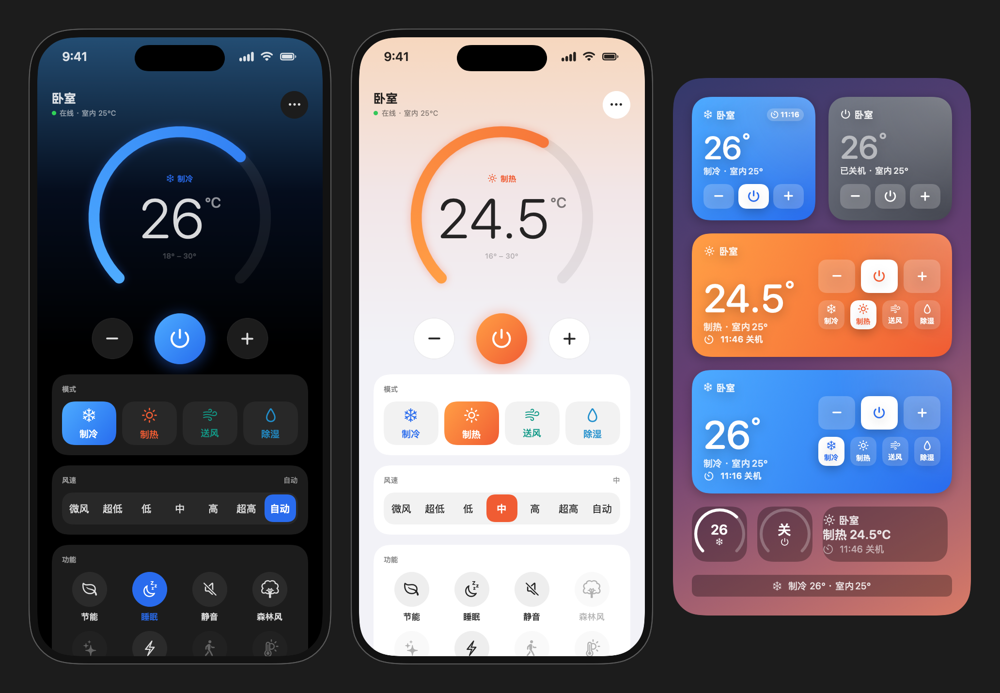
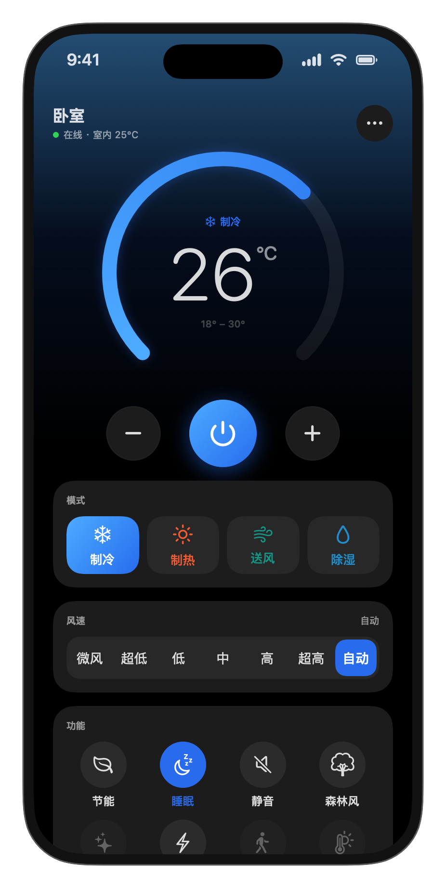
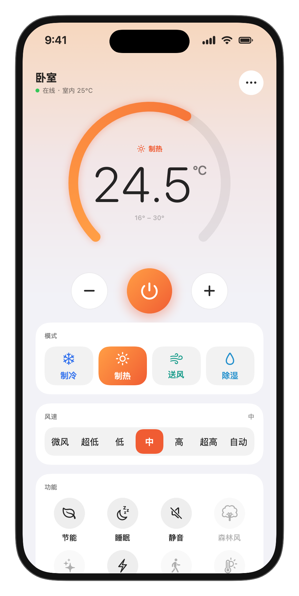
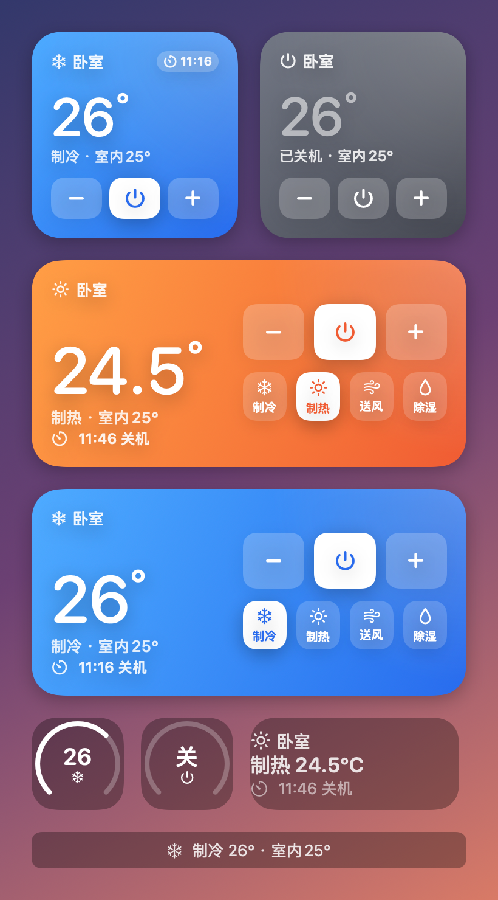
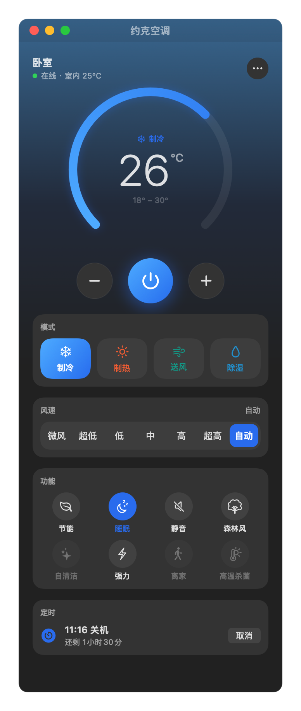

# 约克空调 YorkAC

约克中央空调 Wi-Fi 线控器的第三方客户端：iPhone App、Siri、桌面 / 锁屏小组件、控制中心开关和 Mac 菜单栏。
用的是「约克智慧家」App 同一套云端接口，打开就能用，不用一层层点进去。

*An unofficial iOS / macOS client for York (约克) central air conditioners with Wi-Fi wire controllers — Siri, widgets and a menu bar app, talking to the same cloud API as the official 约克智慧家 app.*

   

## 功能

- **一打开就能用**：先显示上次的状态，后台再同步；温度圆环、开关、模式、风速都在一屏
- **完整控制**：开关机、温度（0.5° 步进）、模式、风速，以及节能、睡眠、静音、森林风、强力、自清洁、离家、高温杀菌等附加功能
  （能不能用、互斥关系、调温/调风速时自动关掉哪些功能，都照约克智慧家的规则）
- **定时**：线控器自带的倒计时，开着就定时关机、关着就定时开机，到点由线控器执行，手机关了也有效
- **Siri**：“约克空调开机”“约克空调调到 26 度”“约克空调打开睡眠”“约克空调两小时后关机”……只发一次请求，回复简短
- **快捷指令 / 自动化**：“设置空调”一步设好开关、模式、温度、风速，可以放进到家、离家、定时等自动化
- **小组件**：主屏小号 / 中号可以直接点按钮开关、调温、切模式；锁屏小组件显示状态；iOS 18 起还有控制中心 / 锁屏开关
- **Mac 版**：窗口 + 菜单栏，菜单栏上直接显示当前温度
- 滤网提醒和复位、故障代码、面板锁定提示、自清洁进行中可停止

| iPhone（深色） | iPhone（浅色） | 小组件 |
| :---: | :---: | :---: |
|  |  |  |

> 截图用的是演示数据（`scripts/screenshots.command` 生成）。

## 支持的设备

能用「约克智慧家」App 控制的约克 Wi-Fi 线控器（彩屏线控器和普通线控器），作者在 **YCWA15NCWQ** 上实际使用。
线控器需要先在约克智慧家里配好网、绑定到账号。

## 安装

### iPhone

需要一台装了 Xcode 16 或更新版本的 Mac，免费的 Apple ID 就行。

1. 克隆仓库，复制 `Config/Local.xcconfig.example` 为 `Config/Local.xcconfig`，填上：
   - `YORK_BUNDLE_ID`：随便起一个自己的，比如 `com.yourname.yorkac`（要全网唯一）
   - `DEVELOPMENT_TEAM`：你的团队 ID（Xcode → Settings → Accounts 里能看到）
2. 双击 `YorkAC.xcodeproj`，顶部选 **YorkAC** 和你的 iPhone，点 ▶︎ 运行
3. 第一次装需要在 iPhone 上打开 **设置 → 隐私与安全性 → 开发者模式**，
   并在 **设置 → 通用 → VPN 与设备管理** 里信任你的开发者证书
4. 打开 App，用约克智慧家的账号登录

> 免费 Apple ID 签名的 App 7 天后会失效，到时在 Xcode 里再点一次 ▶︎ 就行（付费开发者账号是 1 年）。

### Mac

双击 `scripts/build-mac.command`，会编译出 `build/YorkAC.app` 并打开（不需要开发者账号）。
也可以在 Xcode 里选 **YorkAC-Mac** 运行。

## Siri 和自动化

| 对 Siri 说 | 作用 |
| --- | --- |
| 约克空调开机 / 关机 | 开关机 |
| 约克空调调到 26 度 | 设定温度（16–30 度） |
| 约克空调调高温度 / 调低温度 | 温度 ±1 度 |
| 约克空调制冷 / 制热 / 送风 / 除湿 | 切换模式（会同时开机） |
| 约克空调风速自动 | 调风速 |
| 约克空调打开睡眠 / 关闭静音 | 附加功能 |
| 约克空调两小时后关机 / 一小时后开机 / 取消定时 | 定时 |
| 约克空调状态 | 播报当前模式、设定温度和室温 |

“约克空调”也可以只说“空调”。这些也都是「快捷指令」里的动作。

**每天定时开关**：快捷指令 → 自动化 → 新建 → 选时间（或到达 / 离开、连上 Wi-Fi、闹钟……）→ 立即运行 →
添加「设置空调」（开关、模式、温度、风速一步设好）或「定时关空调」。

## 注意事项

- **同一个约克账号只能在一处登录**。本 App 登录后，手机上的约克智慧家会被挤下线，反之亦然。
  建议另注册一个账号，在约克智慧家里把它邀请进同一个家庭，给本 App 专用。
  （本 App 的界面、小组件、Siri 共用同一个登录，彼此不冲突；Mac 版和 iPhone 版之间也会互相挤。）
- 全程走约克云端，需要联网；目前没有局域网直连的方式。
- 账号只保存在本机：登录凭证在 App 的偏好设置里，勾选“记住密码”时密码存在系统钥匙串（用于掉线后自动重连）。
  除了约克的服务器，不会连接任何其他地方。

## 工作原理

约克智慧家 App 背后是海信日立的 hicloud 平台（`1app.hicloud.hisensehitachi.com`）。主要接口：

| 接口 | 用途 |
| --- | --- |
| `GET /login`、`/smsLogin` | 密码 / 短信登录，拿到 token |
| `GET /api/apphome/homes/homeList/deviceList` | 账号下的家庭和线控器 |
| `GET /api/appdevice/homes/{homeId}/xkqs/{xkqCode}` | 线控器的能力位、锁定位、温度范围 |
| `POST /api/appstatus/homes/{homeId}/status` | 状态（带上次的 roundTime 增量查询，和 App 一样每 2 秒一次） |
| `POST /api/appcontrol/cmds/multiIuOuCtrl` | 发控制指令（ctrlJson） |
| `POST /api/appdevice/homes/{homeId}/xkqs/{xkqCode}/simpleTimer` | 简易定时 |

协议和控制规则来自 [ha-york-smart-home](https://github.com/mufeng05/ha-york-smart-home)（Home Assistant 集成）对 App 的分析。

### 代码结构

| 目录 | 内容 |
| --- | --- |
| `Sources/Shared/` | 共享代码：云端接口 `YorkAPI`、状态和指令规则 `ACModel`、登录态与控制 `ACService`、界面状态 `ACStore`、界面 `Views` |
| `Sources/iOS/` | iPhone App 入口、Siri 短语、说明页、图标 |
| `Sources/Intents/` | Siri / 快捷指令动作（App 和小组件共用） |
| `Sources/Widget/` | 主屏 / 锁屏小组件、控制中心开关 |
| `Sources/Mac/` | Mac 版入口（窗口 + 菜单栏） |
| `Sources/Preview/` | Mac 上的界面预览和截图程序（演示数据） |
| `Config/` | Bundle ID、开发者团队等配置 |
| `scripts/` | 编译、检查、预览、截图脚本（可以双击运行） |
| `tools/york_ac.py` | 命令行调试工具（纯 Python 标准库），可以看线控器上报的原始字段 |

iPhone App、Siri 和小组件运行在不同进程，通过 App Group（`group.$(YORK_BUNDLE_ID)`）共享登录态和最近一次的状态。
Siri / 小组件直接用缓存的状态生成指令，只发一次请求，所以响应快。

### 开发脚本

| 脚本 | 作用 |
| --- | --- |
| `scripts/check-ios.command` | 不签名编译一遍 iPhone 版，检查有没有错误 |
| `scripts/build-mac.command` | 编译并打开 Mac 版 |
| `scripts/preview.command` | 打开界面预览（演示数据），同时看 iPhone 深色 / 浅色界面和所有小组件 |
| `scripts/screenshots.command` | 重新生成 `docs/screenshots/` 里的截图 |

## 致谢

- [ha-york-smart-home](https://github.com/mufeng05/ha-york-smart-home)（MIT）——云端协议和控制规则的来源

## 免责声明

本项目是个人开发的非官方客户端，与约克（York）、江森自控、海信日立没有任何关系。
使用的是未公开的云端接口，随时可能失效；请自行承担使用风险。

## 许可

[MIT](LICENSE)
